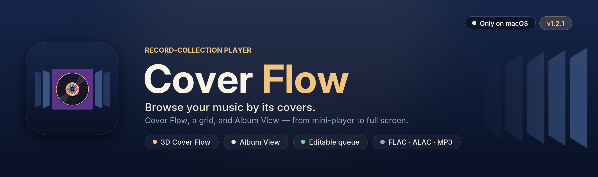

  
  
  

# Cover Flow

A native macOS audio player built around browsing a record collection: a 3D Cover Flow,
a grid, and **Album View**, a player window that scales from a compact mini-player to an
almost full-screen cover.

## Download the macOS app

Download **Cover-Flow-1.0.4-macOS.zip** from the
[1.0.4 release](https://github.com/dustalexw/cover-flow/releases/tag/v1.0.4), unzip it, and move
**Cover Flow.app** to Applications. It runs on Apple-silicon Macs with macOS 14 or later. The app is
ad-hoc signed rather than notarized, so the first time, right-click it and choose **Open**.

## Build & run

Double-click **build.command** in Finder (or run `./build.command` in Terminal). It compiles a
release build with the Swift toolchain from Xcode, assembles **Cover Flow.app** next to the
script, signs it for local use and launches it. Requires macOS 14 or later and Xcode (or the
Command Line Tools). You can drag `Cover Flow.app` into /Applications.

## Gapless playback (source builds)

The current source plays queued tracks as one continuous audio stream, preparing audio ahead
of each transition. Repeat One and Repeat All use the same gapless path. Tracks with different
sample rates or channel counts are converted to a shared output format, and decoding uses a
bounded buffer rather than loading entire songs into memory. Silence already present in a
recording is preserved. The downloadable 1.0.4 release predates this change.

Run the playback checks with `swift test`.

## Last.fm and album selection (source builds)

In **Settings → Last.fm → Set Up Last.fm**, enter the API key and shared secret from your
[Last.fm API account](https://www.last.fm/api/account/create). Choose **Connect Last.fm**,
approve access in your browser, then click **Finish Connecting**. Credentials are saved in
macOS Keychain; Cover Flow never asks for your Last.fm password. You can pause scrobbling or
disconnect in Settings.

Tagged tracks send Now Playing and scrobble after half the song or four minutes of actual
listening, whichever comes first. Tracks must be longer than 30 seconds. Pauses and seeks do
not earn listening credit; demo tracks and tracks with incomplete metadata are skipped.
Eligible listens are cached locally during outages and retried for the same account.
Changing app credentials or disconnecting clears pending listens.

Click an album to select it, **Shift-click** to select a range, and **Command-click** to toggle
individual albums. In Grid, drag across cards to select a group; hold Shift or Command while
dragging to add to the selection. In Cover Flow, Shift-drag or Shift-arrow selects a range.
The selection bar plays or queues albums together in their displayed order. **Command-A**
selects all visible albums and **Escape** clears the selection. Double-click an album or
press Return to show its tracks. The downloadable 1.0.4 release predates these features.

## Why this stack

SwiftUI + AVFoundation, packaged with Swift Package Manager: native 3D transforms and springs
for Cover Flow, AVFoundation for playback and tag/artwork reading, AppKit where SwiftUI is thin
(the Album View window, scroll-wheel capture, open panels, media keys).

## Layout

| Folder | Responsibility |
| --- | --- |
| `Model` | Track / Album values, sort and repeat modes, storage paths |
| `Library` | Import, metadata (AVFoundation + a small FLAC reader), album grouping, artwork cache, persistence, demo collection |
| `Playback` | `PlayerEngine` — queue, shuffle/repeat, seeking, volume, errors, Now Playing + media keys |
| `Scrobbling` | Last.fm authorization, Keychain credentials, listening progress and durable retry queue |
| `Views` | Cover Flow, grid, album sheet, editor, queue, player bar, settings |
| `AlbumView` | Album View window controller (presets, resize, position memory) and its content |

Playback, metadata, collection state and presentation are separate objects, so each can change
without touching the others. Every view observes the same `PlayerEngine`, which keeps state in sync.

## What's saved

Library and playback data stay on this Mac in `~/Library/Application Support/CoverFlow/`:
`Library.json` (collection, edits, play history), `Playback.json` (queue, position, shuffle,
repeat, volume) and `Artwork/` (original cover images). Audio files are read where they are —
never copied, moved or modified. Window layout and preferences use standard macOS defaults.
Last.fm is optional: connecting sends track metadata and listening timestamps to Last.fm.
`LastfmPending.json` stores pending listens locally; API credentials and the session key use Keychain.

## Keyboard

| Keys | Action |
| --- | --- |
| ← → / Home / End / Page Up/Down | Browse Cover Flow |
| Return / Space | Show tracks / play the browsed album |
| ⌘P, ⌘→, ⌘← | Play/Pause, next, previous |
| ⌥⌘→ / ⌥⌘← | Skip ±10 s |
| ⌘↑ / ⌘↓ / ⌥⌘↓ | Volume up / down / mute |
| ⌃⌘S / ⌃⌘R | Shuffle / repeat |
| ⌘1 / ⌘2 | Cover Flow / Grid |
| ⌘U / ⌘L | Queue / show playing album |
| ⇧⌘A | Album View; ⌥⌘1/2/3 Compact / Large / Immersive |
| In Album View | Space, ←/→, 1/2/3 sizes, F artwork focus, Esc exit Immersive / close |

## Brand assets

The app icon, README header and badges are generated by `scripts/make_brand.py`
(`python3 scripts/make_brand.py --version 1.0.4`), following the same layout as the other
dustalexw apps in Cover Flow's navy, ivory and brass.

## Demo collection

Five albums of original music synthesized on first launch, with procedurally drawn covers, all
labelled DEMO. Remove or rebuild them from the File menu or Settings.
